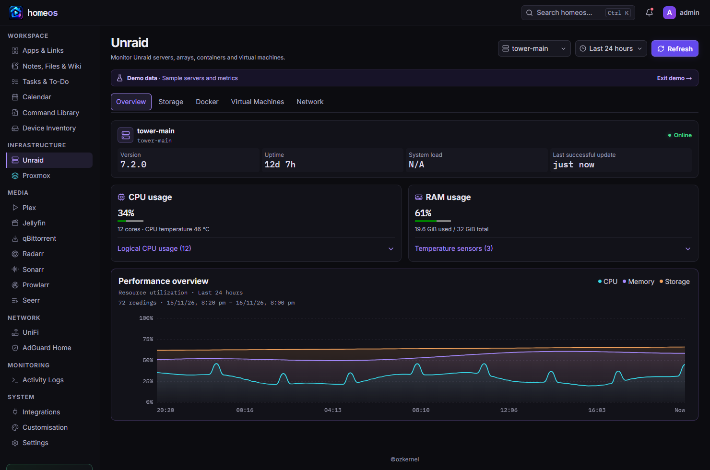
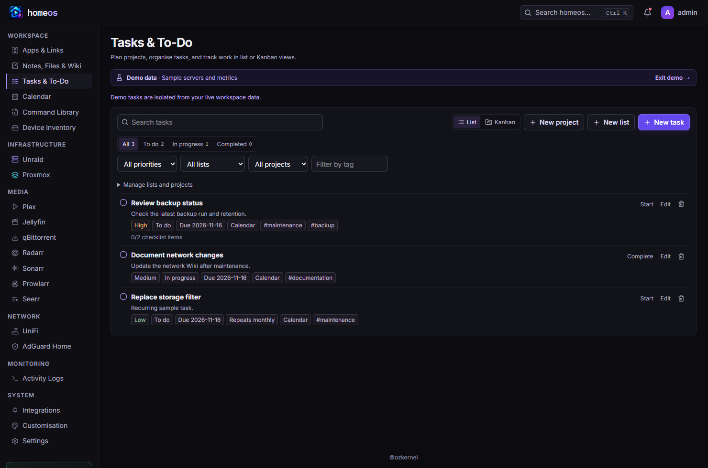

<div align="center">

# HomeOS

**Your home lab. One dashboard.**

A free, self-hosted dashboard for your servers, network, media services and everyday workspace.


[Install](INSTALLATION.md) · [Screenshots](SCREENSHOTS.md) · [Settings](CONFIGURATION.md) · [Help](SUPPORT.md) · [Ideas](https://github.com/ozkernel/homeos/discussions) · [Report a bug](BUG_REPORTING.md)

</div>

[](docs/screenshots/unraid-overview.png)

## What HomeOS does

- **Servers:** Monitor Unraid and Proxmox VE, including hosts, storage, containers and virtual machines.
- **Network:** View UniFi network activity and AdGuard Home DNS statistics.
- **Media:** Connect Plex, Jellyfin, Seerr, Sonarr, Radarr, Prowlarr and qBittorrent. FFmpeg supports media and audio features.
- **Workspace:** Keep app shortcuts, notes, files, music, wiki pages, tasks, calendars and device records together.
- **Make it yours:** Choose themes, icons and widgets; manage accounts, sessions, notifications and alerts.
- **Explore first:** Demo Mode includes sample data. Connecting your own services is optional.

HomeOS connects to services you already run. It does not provide media, downloads or hosted services.

## Quick start

HomeOS runs on **Linux amd64** using the prebuilt Docker image. You don't need the private application source code.

### Unraid

Open the Unraid **Terminal**, then paste:

```sh
mkdir -p /boot/config/plugins/dockerMan/templates-user && curl -fL https://raw.githubusercontent.com/ozkernel/homeos/main/templates/homeos.xml -o /boot/config/plugins/dockerMan/templates-user/my-HomeOS.xml
```

Go to **Docker → Add Container**, choose **HomeOS** under **User Templates**, review the paths and port, and select **Apply**.

Open `http://YOUR-UNRAID-IP:3080`. Follow the first-run administrator setup. If HomeOS asks for a setup token, find it in the **HomeOS container log** in Unraid.

[Full Unraid instructions](INSTALLATION.md#unraid)

### Docker Compose

```sh
git clone https://github.com/ozkernel/homeos.git
cd homeos
cp .env.example .env
docker compose pull
docker compose up -d
```

Open **http://127.0.0.1:3080** on the Docker host and follow the setup screen. The default configuration is local-only; [LAN access needs an extra step](INSTALLATION.md#access-from-other-devices).

**Release status:** The setup files reference `ghcr.io/ozkernel/homeos:2.0.0`. That image can be pulled **after it is published**. Check [Releases](https://github.com/ozkernel/homeos/releases) before installing.

## Screenshots

| Server dashboard | Tasks and workspace |
| --- | --- |
| [](docs/screenshots/unraid-overview.png) | [](docs/screenshots/tasks.png) |

[More about these screenshots](SCREENSHOTS.md) · [What's new in v2.0.0](CHANGELOG.md)

## Help and updates

- **New to HomeOS?** Start with [Installation](INSTALLATION.md), then [Settings and integrations](CONFIGURATION.md).
- **Something not working?** See [Help and troubleshooting](SUPPORT.md).
- **Found a bug?** Follow the [bug reporting guide](BUG_REPORTING.md).
- **Have an idea or question?** Use [GitHub Discussions](https://github.com/ozkernel/homeos/discussions).
- **Security concern?** Use the [private reporting guidance](SECURITY.md), not a public issue.

Before updating, back up your configuration **and** shared files. Never post passwords, API keys, setup tokens or unredacted logs.

## About

HomeOS is free to use and is **proprietary software**, not open source. The official installation files and documentation are public; the application source code is private. Third-party components keep their own licences.

[Licence](LICENSE.md) · [Third-party notices](THIRD_PARTY_NOTICES.md) · [Third-party sources](THIRD_PARTY_SOURCES.md) · [Release notes](RELEASE_NOTES.md)

*HomeOS is an independent project and is not affiliated with the services it integrates with.*
